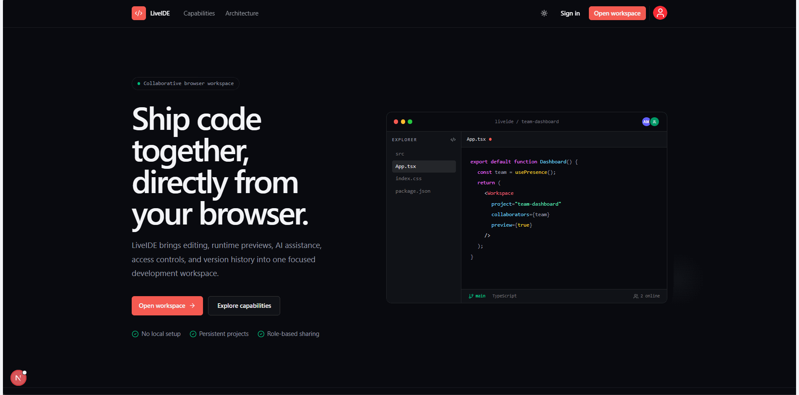

# LiveIDE — Collaborative Development Workspace

**Code, run, preview, and collaborate on web projects in your browser.**

LiveIDE brings a Monaco editor, browser-based Node.js runtime, live previews, and real-time collaboration into one workspace. Create projects from starter templates, invite collaborators, and keep your work with persistent storage and project history.

## Product preview



[Open the development preview](https://liveide-preview-kunal-pehere.vercel.app)

The preview may require Vercel access. Real-time collaboration and AI are currently disabled on this deployment.

## Features

- Multi-file editing with Monaco Editor
- Browser-based execution with WebContainers, an integrated terminal, and live previews
- Starter projects for React, Next.js, Vue, Angular, Express, and Hono
- Persistent projects backed by Prisma and MongoDB
- Owner, editor, and viewer roles with invitation links
- Real-time editing, participant presence, and optional collaborator following
- Shared project notes and runtime status
- Named snapshots and project restore history
- GitHub repository browsing, import, and reviewed commits
- Optional AI chat and inline completion
- GitHub and Google sign-in through Auth.js

AI features require a configured provider. Inline completion runs on `Ctrl+Space`; `Tab` accepts a visible suggestion.

## Technology

| Area | Stack |
| --- | --- |
| Application | Next.js 16, React 19, TypeScript |
| Interface | Tailwind CSS 4, Radix UI, shadcn/ui |
| Editor | Monaco Editor |
| Runtime | WebContainers, xterm.js |
| Data | Prisma, MongoDB |
| Authentication | Auth.js / NextAuth 5 |
| Collaboration | Yjs, y-websocket, y-monaco, optional Redis |
| Testing | Vitest, Testing Library, Playwright |

## Getting started

Use Node.js 22 and npm.

```bash
git clone https://github.com/kunalpehere/LiveIDE.git
cd LiveIDE
npm ci
npm run prisma:generate
```

Create your own local environment configuration using the [setup guide](SETUP.md). Environment and credential files are excluded from this repository.

With MongoDB configured, apply the schema:

```bash
npm run db:push
```

Start the application:

```bash
npm run dev
```

Open [localhost:3000](http://localhost:3000), sign in, and create a project from the dashboard. Development mock mode also provides local guest access; its data is lost when the server restarts.

## Project structure

```text
app/                         Routes, layouts, and API handlers
components/                  Shared interface components
features/                    Authentication, dashboard, editor, AI, and runtime
lib/                         Configuration and shared services
prisma/                      Database schema
scripts/                     Collaboration and maintenance utilities
starter-templates/           Browser-runtime project templates
tests/                       Unit and integration tests
e2e/                         Browser tests
```

## Development checks

```bash
npm run lint
npm run typecheck
npm test
npm run build
npm run test:e2e
```

## Author

Kunal Pehere — [GitHub](https://github.com/kunalpehere)
