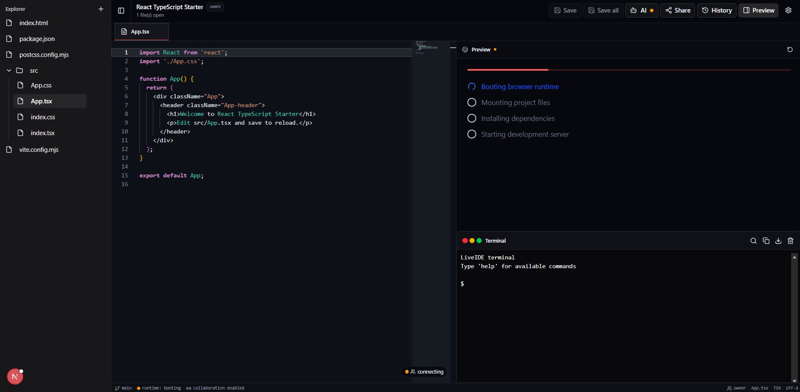
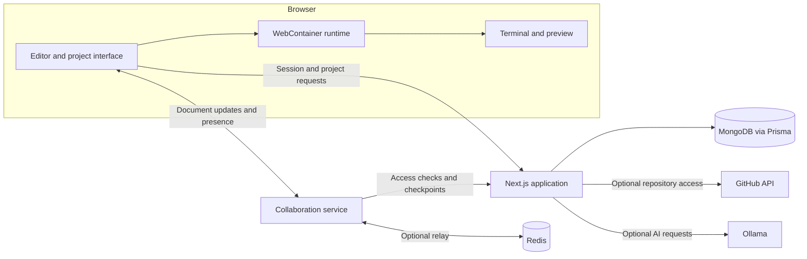

# LiveIDE

**A collaborative browser IDE for editing, running, previewing, and sharing web projects.**

[Getting started](#getting-started) · [Architecture](#architecture) · [Usage](#usage) · [Testing](#testing)

## Overview

LiveIDE gives developers, students, and collaborators a shared place to work on small web projects without configuring a separate runtime for every starter application. It combines a Monaco editor, browser-based Node.js execution, a terminal, live previews, persistent projects, and role-based collaboration.

The project demonstrates full-stack TypeScript development across interactive editor state, WebSocket collaboration, server-side authorization, database persistence, and external-service integration. Its objectives are to reduce setup friction, support collaborative learning and development, and make project changes recoverable through explicit saves and snapshots.

## Screenshots



*Existing workspace capture showing a React TypeScript starter during runtime startup; the interface may differ from the current checkout.*

[View the project dashboard screenshot](docs/images/liveide-projects.png).

Run the application locally at [localhost:3000](http://localhost:3000).

## Features

| Area | What users can do |
| --- | --- |
| Project workspace | Create, reopen, duplicate, and organize projects; create, rename, and delete files and folders; edit multiple files with Monaco. |
| Starter projects | Choose React, Next.js, Vue, Angular, Express, or Hono templates. |
| Browser runtime | Install project dependencies, run a development server, use an integrated xterm.js terminal, and view application previews. |
| Saving and history | Save project files to MongoDB, create named snapshots, and restore earlier project content. Version checks reject conflicting saves. |
| Sharing and permissions | Invite collaborators with editor or viewer access; owners manage membership and invitation links. |
| Real-time collaboration | Synchronize document edits through Yjs, see participant presence, and optionally follow another collaborator's file and cursor. Requires the collaboration service. |
| Shared context | Collaborate on Markdown project notes and opt in to runtime status sharing. Each browser retains its own execution runtime. |
| GitHub workflows | Connect repository access separately from sign-in, browse repositories, review imports, and review changes before explicitly consenting to commits. Requires GitHub integration configuration. |
| Optional AI | Use Ollama-backed chat and manually requested inline completions. AI is disabled by default. |
| Authentication | Sign in with configured GitHub or Google providers, or use guest access in development mock mode. |

Inline completion is requested with `Ctrl+Space`; `Tab` accepts a visible completion. Normal typing and saving do not automatically request AI generation.

## Technology stack

| Category | Technologies used |
| --- | --- |
| Languages | TypeScript, JavaScript, CSS |
| Application | Next.js 16 App Router, React 19, Node.js 22 |
| Interface and state | Tailwind CSS 4, Radix UI, shadcn/ui components, Zustand |
| Editor and execution | Monaco Editor, WebContainers, xterm.js |
| Server and validation | Next.js route handlers and server actions, Zod |
| Database | MongoDB with Prisma 6 |
| Authentication | Auth.js / NextAuth 5 beta |
| Collaboration | Yjs, y-websocket, y-monaco; optional Redis relay |
| AI | Ollama HTTP integration with a configurable model; no model training pipeline |
| Quality and deployment | ESLint, TypeScript, Vitest, Testing Library, Playwright, GitHub Actions; Vercel application build configuration |

## Architecture



The application handles authentication, project access, persistence, and integration requests. A separate Node.js WebSocket process synchronizes Yjs documents and persists collaboration checkpoints through the application. Browser runtimes execute each participant's project locally; runtime status sharing does not provide a shared shell.

## Project structure

```text
app/                         Pages, layouts, route handlers, and workspace entry points
components/                  Shared interface components
features/
  auth/                      Sign-in interface and user helpers
  dashboard/                 Project listing and creation
  playground/                Editor, sharing, notes, and history
  webcontainers/             Runtime lifecycle, preview, and terminal
  github/                    Repository connection, import, and commit interface
  ai-chat/                   AI interface, validation, and provider integration
lib/                         Shared services, configuration, and resource policies
prisma/schema.prisma         MongoDB data model
scripts/                     Collaboration service and verification utilities
starter-templates/           Starter application files
tests/                       Unit and integration tests
e2e/                         Playwright browser scenarios
docs/images/                 Product screenshots
```

## Getting started

### Prerequisites

- Node.js **22.x**, matching `package.json` and `.nvmrc`, and npm.
- A browser with WebAssembly, workers, service workers, and SharedArrayBuffer support. Project execution requires HTTPS or localhost and cross-origin isolation; the application's compatibility check suggests current desktop Chrome or Edge when capabilities are missing.
- A MongoDB replica set for persistent operation and transaction support, or development mock mode for a temporary local walkthrough. The repository does not pin a MongoDB server version.
- A configured GitHub or Google sign-in provider for persistent operation. Repository integration uses a separate GitHub OAuth application.
- Optional: Ollama with the chosen model available, and Redis when using the collaboration relay.

### 1. Install

```bash
git clone <repository-url>
cd LiveIDE
npm ci
npm run prisma:generate
```

### 2. Configure local services

Configure the application locally for either persistent MongoDB storage with a sign-in provider or development mock mode for a temporary walkthrough. Keep local configuration outside version control.

Guest access is available only in development mock mode. Mock data is held in memory and lost when the server restarts. Optional collaboration, GitHub repository integration, and Ollama assistance each require their corresponding services to be configured before use.

### 3. Initialize persistent storage

With MongoDB configured, apply the schema:

```bash
npm run db:push
```

Skip this step in mock mode. The project uses Prisma's MongoDB schema push rather than SQL migration files. Choose a development database you control before applying schema changes.

### 4. Start the application

```bash
npm run dev
```

Open [localhost:3000](http://localhost:3000) and sign in, or choose guest access in mock mode.

For collaboration, configure the application and collaboration service locally. With their settings supplied through your shell environment, start the service in a second terminal:

```bash
npm run collaboration:server
```

Alternatively, `npm run dev:collaboration` starts both processes when their settings are available in the shell environment.

Production builds require valid production configuration and MongoDB. Mock mode is restricted to development. The Vercel configuration builds the Next.js application; the separate collaboration process needs a suitable service host.

## Usage

1. Open **Projects** at `/dashboard`, choose **Create project**, select a starter, and open its workspace at `/playground/<project-id>`.
2. Open files in the explorer, edit them, and use **Save** or **Save all** to persist changes. Use the runtime and preview controls to run the application and inspect terminal output.
3. With collaboration configured, open **Share**, grant editor or viewer access, and invite another signed-in participant. Use **Follow collaborator** to follow an online participant.
4. Use **Notes** for shared Markdown context and **Shared runtime** to inspect opted-in runtime status. These collaboration features require the collaboration service.
5. Save your edits before creating a named snapshot in **History**. Snapshots capture persisted project content; owners and editors can restore earlier snapshots.
6. For repository workflows, connect GitHub from the dashboard, browse and review an import, then review project changes before enabling and confirming a commit. GitHub sign-in alone does not enable repository access.
7. Optionally enable Ollama-backed AI chat or request an inline completion. Code and prompts used for AI requests are sent to the configured provider.

## Selected application endpoints

These routes support the web application; this table is not a standalone public API specification. Session-protected routes may redirect unauthenticated visitors to sign-in. Examples describe response shapes, not recorded live responses.

| Method | Path | Purpose | Authentication | Safe request / response example |
| --- | --- | --- | --- | --- |
| `GET` | `/api/health/live` | Application liveness | No user session required | No body → `{"service":"liveide","status":"healthy"}` |
| `GET` | `/api/template/<project-id>` | Load the authorized project's starter file tree | Signed-in user with project access | No body → `{"success":true,"templateJson":{...}}` (abbreviated tree) |
| `POST` | `/api/chat` | Generate an AI response | Signed-in user; project access checked when a project ID is supplied; AI must be enabled | `{"message":"Explain JavaScript closures","stream":false}` → `{"response":"<generated answer>","model":"<configured model>","timestamp":"<ISO timestamp>"}` |

Project creation, saving, membership, and history also use server actions.

## Testing

| Command | Scope |
| --- | --- |
| `npm run lint` | ESLint checks |
| `npm run typecheck` | Next.js generated types, application TypeScript, and collaboration transport types |
| `npm test` | Vitest unit and integration tests |
| `npm run build` | Production application build; requires valid production configuration |
| `npm run test:e2e` | Playwright browser scenarios, including checks against a built production app |
| `npm run test:e2e:collaboration` | Dedicated collaboration browser scenarios |
| `npm run verify` | Lint, type checking, unit/integration tests, and build |

Tests cover authorization, project files, invitations, snapshots, resource limits, AI request handling, GitHub integration, collaboration synchronization and recovery, runtime lifecycle, and preview behavior. GitHub Actions defines automated checks; no current CI pass status is asserted here.

Install the Playwright Chromium browser before browser tests with `npx playwright install chromium` and build the app before running scenarios that start the production server. Real WebContainer preview and startup scenarios are opt-in; ordinary browser tests do not establish live runtime performance. The database recovery tests require their isolated recovery fixture and are skipped without it.

Available test commands are listed above; current pass counts and benchmark results are not published in this README.

## Constraints and proposed improvements

- Browser execution depends on compatible browser APIs and isolation headers; editing and saving can remain available when runtime requirements are missing.
- Projects are bounded to 250 files, 256 KiB per file, and 2 MiB of total file content. Snapshot storage is capped at 50 snapshots per project.
- Runtime status sharing does not provide shared terminal input or one remote execution environment.
- AI currently implements Ollama only; output quality depends on the configured model. No training dataset or evaluation benchmark is included.
- Mock mode is intended for local exploration and does not replace verification against real MongoDB, OAuth, GitHub, or deployed collaboration services.

Possible future improvements include a verified public demo with current walkthrough assets, reproducible runtime benchmarks across supported browsers, and additional AI providers with evaluation fixtures. These are proposals, not completed capabilities.

## Contributing and license

Open an issue to discuss substantial changes. For contributions, keep changes focused, add relevant verification, run the checks above, and exclude credentials and personal data from commits.

No license file is present in this repository. Do not assume a particular open-source license or redistribution permission.
